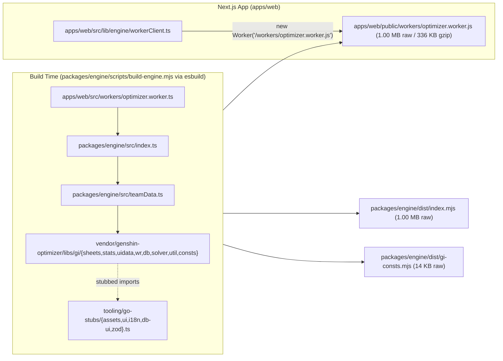

# Implementation Plan: Trim Genshin Optimizer Runtime & Prebuild Headless Engine

**Branch**: `trim-go-runtime` | **Date**: 2026-11-06 | **Spec**: [spec.md](file:///y:/Repos/gi-optimizer/specs/trim-go-runtime/spec.md)  
**Input**: Feature specification from `specs/trim-go-runtime/spec.md`

## Summary

Eliminate the 123.52 MB (2,732 game-art PNGs) static export bloat and shrink the optimizer web worker bundle by more than 50% (`~2.4 MB` raw → `~1.00 MB` raw / `~336 KB` gzip, well under the `≤ 1.2 MB` raw budget) without modifying a single file inside `vendor/genshin-optimizer`:
1. Stub `@genshin-optimizer/gi/assets`, `@genshin-optimizer/gi/assets-data`, `@genshin-optimizer/common/ui`, `@genshin-optimizer/common/svgicons`, `@genshin-optimizer/gi/i18n`, `@genshin-optimizer/gi/ui`, `@genshin-optimizer/gi/db-ui`, and `@genshin-optimizer/gi/svgicons` in `tooling/go-stubs/` (`assets.ts`, `ui.ts`, `i18n.ts`, `db-ui.ts`, `zod.ts`) and map them in `tooling/go-paths.mjs`.
2. Port headless `getTeamData`, `getTeamDataCalc`, `getBuildTcArtifactData`, and `getBuildTcWeaponData` into `packages/engine/src/teamData.ts` and switch all engine/script/test imports off `@genshin-optimizer/gi/ui/useTeamData`.
3. Add `packages/engine/scripts/build-engine.mjs` (`esbuild`) to prebuild `apps/web/public/workers/optimizer.worker.js`, `packages/engine/dist/index.mjs`, and `packages/engine/dist/gi-consts.mjs`, wire it into `packages/engine` and root `build`/`dev` scripts, spawn `new Worker('/workers/optimizer.worker.js')` in `apps/web/src/lib/engine/workerClient.ts`, and remove `@gi/engine` and raw `@genshin-optimizer/*` TypeScript transpilation from `apps/web/next.config.ts`.

## Technical Context

**Language/Version**: TypeScript 5 strict (`ES2022` target, `bundler` moduleResolution)  
**Primary Dependencies**: Next.js 16 App Router (static export `output: 'export'`), React 19, Tailwind CSS, `idb`, `esbuild` (via workspace `node_modules`), vendored Genshin Optimizer (`vendor/genshin-optimizer`, read-only)  
**Storage**: Browser IndexedDB via `idb` (`gi-optimizer-db` v1) — unchanged by this feature  
**Testing**: Vitest (`packages/engine/test/golden.test.ts`, `packages/engine/test/spike.test.ts`), Playwright for UI smoke  
**Target Platform**: Static browser web app + Web Worker (`apps/web/out`)  
**Project Type**: pnpm monorepo (`apps/web`, `packages/engine`, `packages/presets`, `packages/good`, `tooling`)  
**Performance Goals**: `apps/web/out` `< 15 MB` total with `0` PNGs (down from `128.96 MB` / `2,732` PNGs); `apps/web/public/workers/optimizer.worker.js` `≤ 1.2 MB` raw (verified `1.00 MB` raw / `335.7 KB` gzip); cold worker spawn to first `/optimize` evaluation measured and reported  
**Constraints**: Never edit or delete any file in `vendor/genshin-optimizer`; `0%` drift on all 11 golden damage fixtures (`≤ 0.1%` constitutional tolerance); Next.js (`next dev` / `next build`) must never transpile raw `@genshin-optimizer/*` or `@gi/engine` TypeScript source  
**Scale/Scope**: 5 stub modules in `tooling/go-stubs/`, 1 headless `teamData.ts` module in `packages/engine/src/`, 1 `esbuild` prebuild script in `packages/engine/scripts/build-engine.mjs`, and build/worker config updates in `tooling/go-paths.mjs`, `packages/engine/package.json`, `package.json`, `apps/web/src/lib/engine/workerClient.ts`, and `apps/web/next.config.ts`

## Constitution Check

*GATE: Must pass before Phase 0 research. Re-checked after Phase 1 design.*

- **I. Engine Delegation (Never Re-Derive Game Math)**: **PASS**. `packages/engine/src/teamData.ts` is a verbatim headless port of `getTeamData`, `getTeamDataCalc`, `getBuildTcArtifactData`, and `getBuildTcWeaponData` from `vendor/genshin-optimizer/libs/gi/ui/src/hooks/useTeamData.ts` using GO's own `@genshin-optimizer/gi/sheets`, `@genshin-optimizer/gi/stats`, `@genshin-optimizer/gi/uidata`, and `@genshin-optimizer/gi/wr`. Verified `11/11` golden fixtures match with `0%` error.
- **II. Preset Fidelity (Import, Never Invent)**: **PASS**. No preset JSON or preset schema changes.
- **III. Local-First, Static-Only, Zero-Backend**: **PASS**. Shrinks the static export from `128.96 MB` to `< 15 MB` (`~4.2 MB`) and serves the worker from `/workers/optimizer.worker.js` inside the static export.
- **IV. Web Worker Isolation for All Engine Work**: **PASS**. `workerClient.ts` spawns `new Worker('/workers/optimizer.worker.js')` directly off the main thread; main-thread routes never bundle GO sheets or solver code.
- **V. Simplicity & YAGNI**: **PASS**. Uses `esbuild` already present in workspace `node_modules` and small deterministic stub files in `tooling/go-stubs/`.

## Project Structure

### Documentation (this feature)

```text
specs/trim-go-runtime/
├── spec.md
├── plan.md
├── research.md
├── data-model.md
├── tasks.md
└── checklists/
    └── requirements.md
```

### Source Code (repository root — files owned or touched by `trim-go-runtime`)

```text
tooling/
├── go-paths.mjs                          # Map @genshin-optimizer/gi/{assets,assets-data,i18n,ui,db-ui,svgicons} & common/{ui,svgicons} to tooling/go-stubs/*
└── go-stubs/
    ├── assets.ts                         # Recursive empty-string proxy stub for @genshin-optimizer/gi/assets & assets-data
    ├── ui.ts                             # Lightweight { type, props } stub for @genshin-optimizer/common/ui, gi/ui, svgicons, react/emotion jsx-runtime, @mui/material
    ├── i18n.ts                           # Lightweight Translate stub for @genshin-optimizer/gi/i18n
    ├── db-ui.ts                          # Headless stub for @genshin-optimizer/gi/db-ui
    └── zod.ts                            # Lightweight schema normalizer stub for prebuilt engine/worker bundles

packages/engine/
├── package.json                          # Add "build": "node scripts/build-engine.mjs", set "main": "./dist/index.mjs"
├── scripts/
│   ├── build-engine.mjs                  # esbuild bundler emitting apps/web/public/workers/optimizer.worker.js, dist/index.mjs, dist/gi-consts.mjs
│   └── capture-golden.ts                 # Switch getTeamDataCalc import to ../src/teamData
├── src/
│   ├── teamData.ts                       # Headless port of getTeamData, getTeamDataCalc, getBuildTcArtifactData, getBuildTcWeaponData
│   ├── session.ts                        # Switch getTeamData import to ./teamData
│   ├── solver.ts                         # Switch getTeamData import to ./teamData
│   └── catalog.ts                        # Switch getTeamData import to ./teamData
└── test/
    ├── golden.test.ts                    # Switch getTeamDataCalc import to ../src/teamData + add stub/bundle verification assertions
    └── spike.test.ts                     # Switch getTeamDataCalc import to ../src/teamData

apps/web/
├── next.config.ts                        # Remove @gi/engine from transpilePackages, remove raw GO source aliases, alias @gi/engine & @genshin-optimizer/gi/consts to prebuilt dist/*.mjs
├── public/
│   └── workers/
│       └── optimizer.worker.js           # Prebuilt minified worker bundle (≤ 1.2 MB raw; gitignored or generated on build/dev)
└── src/
    └── lib/
        └── engine/
            └── workerClient.ts           # Spawn new Worker('/workers/optimizer.worker.js')

package.json                              # Wire @gi/engine build into root "build" and "dev" scripts
```

**Structure Decision**: Existing pnpm workspace layout is preserved. All GO runtime stubs live in `tooling/go-stubs/` as mandated by the feature scope, headless `teamData.ts` lives in `packages/engine/src/teamData.ts`, and `packages/engine/scripts/build-engine.mjs` produces both `packages/engine/dist/index.mjs` and `apps/web/public/workers/optimizer.worker.js`.

## Implementation Architecture



### Key Technical Details

1. **`tooling/go-stubs/assets.ts` Recursive Proxy**:
   - `vendor/genshin-optimizer/libs/gi/sheets/src/Characters/characterUtil.tsx` (`talentTem`) reads `imgAssets.weaponTypes[weaponTypeKey]`.
   - `imgAssets` and `AssetData` are backed by a recursive callable `Proxy` that returns itself on property access and `""` on function call or primitive coercion (`Symbol.toPrimitive`), while `artifactDefIcon`, `characterAsset`, and `weaponAsset` are `() => ""`.

2. **`tooling/go-stubs/ui.ts` & `i18n.ts` Descriptor Nodes**:
   - `extractReactNodeText` in `packages/engine/src/catalog.ts` checks `obj.type === 'Translate'` or `obj.type?.name === 'Translate'`, reads `props.ns` and `props.key18` to look up English strings in `en/<ns>.json`, and recurses into `props.children`.
   - Because `vendor/genshin-optimizer/libs/gi/sheets/tsconfig.json` configures `"jsxImportSource": "@emotion/react"`, `.tsx` files in `libs/gi/sheets` emit `jsx(Translate, { ns, key18 })` via `@emotion/react/jsx-runtime`.
   - Exporting `jsx = (type, props) => ({ type, props: props ?? {} })`, `jsxs = jsx`, `Fragment = 'Fragment'`, `Translate = 'Translate'`, `ColorText = 'ColorText'`, `SqBadge = 'SqBadge'`, `Box = 'Box'`, `ImgIcon = () => null`, `useEffect = () => {}`, and `useState = (v) => [typeof v === 'function' ? v() : v, () => {}]` satisfies every sheet module while keeping `extractReactNodeText` output 100% identical to baseline.

3. **`packages/engine/scripts/build-engine.mjs` Pipeline**:
   - Resolves `esbuild` from workspace `node_modules` (with fallback through `vitest` → `vite` → `esbuild`).
   - Applies the `go-trim` esbuild plugin:
     - Resolves `@genshin-optimizer/*` using `goAliases(repoRoot)` from `tooling/go-paths.mjs` (which already maps the stubbed GO UI/asset packages to `tooling/go-stubs/*`).
     - Resolves `react`, `react/jsx-runtime`, `react/jsx-dev-runtime`, `@emotion/react`, `@emotion/react/jsx-runtime`, `@emotion/react/jsx-dev-runtime`, `@mui/material`, `@mui/icons-material`, `i18next`, and `react-i18next` to `tooling/go-stubs/ui.ts`.
     - Resolves `zod` to `tooling/go-stubs/zod.ts`.
     - Resolves `@gi/presets` (inside engine/worker bundle) to re-export `packages/presets/src/names.ts` and `packages/presets/src/settings.ts` only, avoiding bundling `packages/presets/data/**/*.json` into the worker.
     - Transforms `vendor/genshin-optimizer/libs/gi/stats/src/allStat_gen.json` on load: strips `raw.material` and gzip-compresses `{ char, weapon, art }` into base64 decoded at module init via `unzipFromB64Gzip` from `@genshin-optimizer/common/util`, exporting `export const { char, weapon, art } = data; export default data;`.
     - Transforms `vendor/genshin-optimizer/libs/gi/sheets/src/**/*.tsx` on load: replaces UI-only `fields: [...]` arrays with `fields: []` via a balanced-bracket scanner that respects string literals and comments, preserving all `states` conditionals and formula trees.
   - Emits:
     - `apps/web/public/workers/optimizer.worker.js` (`format: 'iife'`, `platform: 'browser'`, `minify: true`, `target: 'es2022'`)
     - `packages/engine/dist/index.mjs` (`format: 'esm'`, `platform: 'neutral'`, `minify: true`, `target: 'es2022'`)
     - `packages/engine/dist/gi-consts.mjs` (`format: 'esm'`, `platform: 'neutral'`, `minify: true`, `target: 'es2022'`)

4. **Coordination with Sibling Features (`slim-data-pages`, `loading-and-bundle`, `teams-deferred-start`)**:
   - `slim-data-pages` owns `packages/good/src/*`, `packages/presets/src/*`, and `apps/web/src/app/{import,presets,teams}/page.tsx`. `trim-go-runtime` does NOT touch any of those files.
   - `loading-and-bundle` owns `apps/web/src/app/**/loading.tsx`, `apps/web/src/components/PageSkeleton.tsx`, and `apps/web/scripts/measure-bundle.mjs`. `trim-go-runtime` does NOT touch those files.
   - `teams-deferred-start` owns `apps/web/src/app/teams/page.tsx`. `trim-go-runtime` does NOT touch that file.
   - In `apps/web/src/lib/engine/workerClient.ts`, changing `new Worker(new URL('../../workers/optimizer.worker.ts', import.meta.url))` to `new Worker('/workers/optimizer.worker.js')` is a 1-line change that preserves the `OptimizerWorkerClient` class and `getOptimizerWorker()` singleton contract.

## Complexity Tracking

No constitution violations. No complexity exemptions required.

